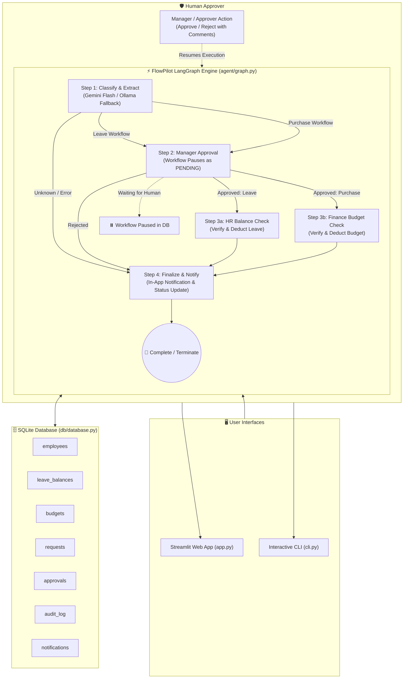

# ⚡ FlowPilot: Autonomous Workflow Agent
Live Demo: https://flowpilot-csmbfgpjteptublv6oqvhj.streamlit.app/

> **An autonomous multi-step, multi-department business workflow orchestrator with human-in-the-loop approvals, powered by LangGraph, Google Gemini Free Tier, and SQLite. 100% free tools with zero paid APIs.**

[](https://www.python.org/)
[](https://github.com/langchain-ai/langgraph)
[-brightgreen.svg)](https://aistudio.google.com/)
[](https://www.sqlite.org/)
[](https://streamlit.io/)
[](tests/)

---

## 📌 The Problem & Solution

### The Problem
Traditional business workflows (time-off approvals, equipment procurement, budget checks) are fragmented across emails, spreadsheets, and manual follow-ups. Approvals get stalled, departmental checks (HR balances, Finance budgets) are error-prone, and audits lack transparent step-by-step reasoning.

### The FlowPilot Solution
**FlowPilot** is an autonomous AI agent that:
1. **Understands Natural Language**: Accepts plain-English employee requests (e.g., *"I need 2 days leave next week"* or *"Order 2 Dell 4K monitors for $800"*).
2. **Extracts Structured Data**: Uses free-tier Google Gemini flash models to classify workflows and extract clean JSON parameters.
3. **Orchestrates State Machines**: Powered by **LangGraph**, it executes business logic in discrete deterministic nodes.
4. **Human-in-the-Loop Approvals**: Automatically pauses workflows as `PENDING`, alerts approvers, and seamlessly resumes upon approval or rejection.
5. **Audits Every Step**: Logs every reasoning step, LLM decision, and tool invocation to a permanent audit database.

---

## 🏗️ Architecture Diagram



---

## 🔄 Supported Workflows (Max 4 Steps Each)

### 1. Leave Request Workflow
```
[Employee Request] ➡️ [Manager Approval] ➡️ [HR Balance Check & Deduction] ➡️ [Notification]
```
- **Step 1 (Classify)**: Classifies plain-English request as `leave`, extracts days, start date, leave type (`annual`, `sick`, `casual`), and reason.
- **Step 2 (Approval)**: Creates pending approval record for Manager and pauses graph.
- **Step 3 (HR Verification)**: Checks SQLite `leave_balances`. If balance is sufficient, deducts days. If insufficient, marks failure.
- **Step 4 (Notification)**: Sends employee confirmation or rejection notice and logs complete audit trail.

### 2. Purchase Request Workflow
```
[Employee Request] ➡️ [Manager Approval] ➡️ [Finance Budget Check & Deduction] ➡️ [Notification]
```
- **Step 1 (Classify)**: Classifies request as `purchase`, extracts department, item name, dollar amount, and business justification.
- **Step 2 (Approval)**: Pauses execution awaiting Manager approval.
- **Step 3 (Finance Check)**: Validates available funds in department's `budgets`. Deducts purchase cost if remaining budget allows.
- **Step 4 (Notification)**: Emits notification with budget details and finalizes status (`completed`, `rejected`, or `failed`).

---

## 🛠️ Tech Stack (100% Free Tools)

| Component | Technology | Rationale |
| :--- | :--- | :--- |
| **Language** | Python 3.11+ | Clean, readable, robust typing with `pydantic` |
| **LLM** | Google Gemini API (Free Tier) | Uses `gemini-3.5-flash-lite` / `gemini-3.8-flash` free tier |
| **LLM Fallback** | Local Ollama / Deterministic Regex | Fallback to Ollama or rule parser if offline or rate-limited |
| **Orchestration** | LangGraph | State machine with human-in-the-loop pause & resume |
| **Database** | SQLite3 | Native relational database without Docker or cloud hosting |
| **Frontend** | Streamlit | Fast, intuitive dashboard for employees and approvers |
| **Testing** | Pytest | 22 comprehensive unit and integration tests |

---

## 🚀 Quickstart Guide

### 1. Prerequisites
- Python 3.11 or higher installed
- Free Gemini API key from [Google AI Studio](https://aistudio.google.com/)

### 2. Clone and Setup Environment
```powershell
# Clone the repository
git clone https://github.com/dileep-kumar-cse/flowpilot.git
cd flowpilot

# Create virtual environment
python -m venv venv

# Activate virtual environment
# Windows PowerShell:
.\venv\Scripts\Activate.ps1
# Linux / macOS:
# source venv/bin/activate

# Install dependencies
pip install -r requirements.txt
```

### 3. Configure Environment Variables
Copy `.env.example` to `.env` and insert your Gemini API Key:
```ini
GEMINI_API_KEY=your_free_gemini_api_key_here
LLM_MODEL=gemini-3.5-flash-lite
USE_OLLAMA_FALLBACK=false
```
*(Note: `.env` is ignored by `.gitignore` and is never committed).*

### 4. Database initialization
The Streamlit app creates its SQLite database, schema, and sample employees,
budgets, and balances automatically the first time it starts. To seed the
database manually instead:
```powershell
python -m db.seed
```

---

## 💻 Running FlowPilot

### Option A: Streamlit Web UI (Recommended)
Launch the visual web application:
```powershell
streamlit run app.py
```
Open **`http://localhost:8501`** in your browser:
- **👤 Employee Portal**: Choose an employee, click quick-fill prompt chips or type your own request, and submit.
- **🛡️ Approver Dashboard**: Switch approver roles (Manager, Finance, HR), review pending requests, and click **Approve** or **Reject**.
- **📜 Audit & Reasoning Trail**: Inspect live step-by-step agent decisions, LLM parameters, tool calls, and departmental budgets.

### Option B: Interactive & Automated CLI
Launch the interactive command-line interface:
```powershell
python cli.py
```

Or run automated CLI actions:
```powershell
# Automated leave request with approval:
python cli.py --request "I need 2 days annual leave from Nov 5" --action approve

# Automated purchase request with approval:
python cli.py --request 'Purchase 2 Dell UltraSharp monitors for $800' --action approve

# Automated rejection test:
python cli.py --request 'Purchase 1 ergonomic chair for $500' --action reject --comment "Not an essential expense"
```

---

## 🧪 Running Automated Tests

Run the full test suite with verbose output (workflow tests use a deterministic
local classifier mock and do not call Gemini):
```powershell
python -m pytest tests/ -v
```

### Test Coverage Highlights:
- **Phase 1 (`tests/test_phase1.py`)**: Database schema, foreign key relations, seed idempotency, balance checks, and budget tools.
- **Phase 2 (`tests/test_phase2.py`)**: Leave extraction, approval pause, approval deduction, rejection routing.
- **Phase 3 (`tests/test_phase3.py`)**: Purchase extraction, finance budget validation, budget deduction, insufficient funds handling.
- **Phase 5 (`tests/test_phase5_error_handling.py`)**: JSON markdown parsing, rate-limit fallback, non-existent employee/department checks, unknown request routing.

---

## 📂 Repository Structure

```
FlowPilot/
├── agent/
│   ├── __init__.py
│   ├── graph.py         # LangGraph workflow state machine & pause/resume logic
│   ├── llm.py           # Multi-model Gemini client, retries, and Ollama fallback
│   ├── prompts.py       # System prompt, JSON schemas, and regex fallback rules
│   └── tools.py         # Mock tools: check_leave, check_budget, deduct, notify
├── db/
│   ├── __init__.py
│   ├── database.py      # SQLite schema, connection factory, and audit logging
│   └── seed.py          # Sample data: employees, leave balances, budgets
├── .streamlit/
│   └── config.toml      # Light Streamlit theme
├── ui/
│   ├── __init__.py
│   ├── employee_view.py # Employee submission portal & request tracker
│   ├── approver_view.py # Human-in-the-loop review dashboard (Approve/Reject)
│   ├── audit_view.py    # Audit trail, analytics, and company status viewer
│   └── styles.py        # Shared interface styling
├── tests/
│   ├── conftest.py       # Deterministic LLM classifier mock
│   ├── __init__.py
│   ├── test_phase1.py   # Database and mock tool tests
│   ├── test_phase2.py   # Leave workflow tests
│   ├── test_phase3.py   # Purchase workflow tests
│   └── test_phase5_error_handling.py # Error handling & edge cases
├── app.py               # Streamlit application entry point
├── cli.py               # Interactive and automated CLI test runner
├── requirements.txt     # Locked production dependencies
├── .env.example         # Template configuration (no secrets)
├── .gitignore           # Git ignore protecting .env, DB, venv, and caches
└── README.md            # Architecture, documentation, and quickstart guide
```

## 🤖 AI Assistance

This project was built with AI assistance.

---

## 🛡️ Security & Privacy
- **Zero API Key Leakage**: `.env` is strictly excluded in `.gitignore` and never committed or logged.
- **100% Free Tools**: Operates entirely within the free-tier Google Gemini flash models or local Ollama instances with zero cloud costs.
- **Full Traceability**: Every decision, approval, deduction, and notification is recorded with timestamps in the SQLite `audit_log`.
